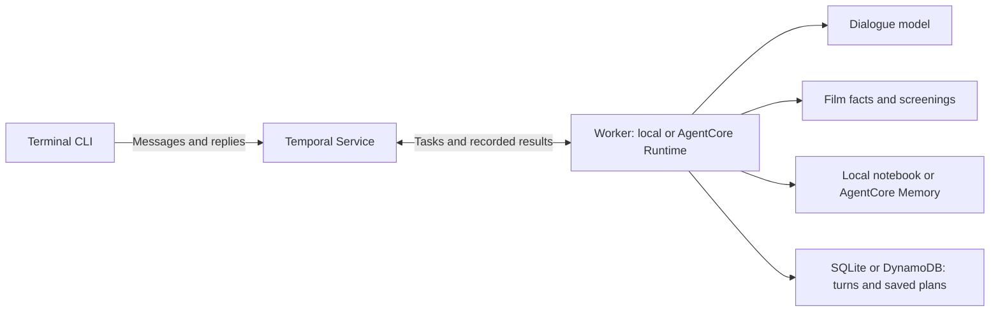

# Nicole: A serverless agent with long-term memory

AI agents need to keep track of a conversation while they work and carry useful
information into later conversations. If the conversation and next step live only
in the running process, stopping that process means losing progress. Serverless
applications need to handle this routinely, because compute can stop while the
agent is waiting for a reply. The failure mode is a **lost conversation**: the
agent forgets what you said tonight and where the work stood. They also need to decide which information belongs
to the current interaction and which is worth keeping for the next one.

This repo shows how to handle both with Nicole, a film-recommendation agent built
with Temporal and Amazon Bedrock AgentCore. Temporal preserves the conversation
and execution progress so another Worker can continue where the previous one
stopped. AgentCore Memory keeps film preferences across visits, while AgentCore
Runtime hosts the Workers. Tonight’s constraints stay with the current movie
night, and lasting taste helps with future recommendations. The walkthrough
explains how that state and memory become context for each model call, so you
can use the same approach in your own serverless agent.

> [!IMPORTANT]
> **For Lenny before merge** (from Melanie's review; remove this block once done):
>
> 1. **Image:** add a screenshot or GIF of the terminal with the state and
>    memory panels right here, under the intro. A short clip from the video works
>    too.
> 2. **Cost:** replace the estimate in [Cost to run](#cost-to-run) with one
>    measured live movie night: model calls, input and output tokens, dollars,
>    and the date. OpenRouter's activity page lists each request.
> 3. **Two files:** `examples/legacy_memory.py` (an offline prototype) and
>    `scripts/render_frames.py` (renders presentation fixtures). If readers use
>    them, say what for in the README. If they're only for presenting, move them
>    out of the repo.
> 4. **Errors:** add the three errors people hit most as a table (You see,
>    Cause, Fix) with exact strings from real runs.
> 5. **Acknowledgments:** name everyone who reviewed the demo.
> 6. **Video:** add the link and chapters once it's published.

**Last verified:** 2026-11-04 (tests and the offline demo). The live AgentCore
checks weren't re-run; they last passed 2026-10-30.

## How to run Nicole

Install Python 3.11+, [uv](https://docs.astral.sh/uv/), and the
[Temporal CLI](https://docs.temporal.io/cli), then run:

```sh
uv sync --group dev   # or: make setup; exits 0
```

### Offline demo (no keys)

```sh
uv run nicole stage   # or: make run
```

Press Enter at each prompt, or add `--auto --width 100` to run unattended with
Event History replay. What you'll see:

| Moment | On screen |
| --- | --- |
| A second visit starts in a new Worker process | `NEW TEMPORAL WORKER`, and `Favorite films: Arrival, …` comes back from the notebook |
| A tonight-only answer | `No lasting preference added` |
| The Worker stops before the plan is saved | `WORKER GONE`, with `Next: save tonight's pick` |
| A new Worker finishes the evening | `NEW TEMPORAL WORKER`, `✓ Saved for tonight`, then `Remembered taste. Resumed work. A lovely evening.` | Use a terminal at least 100 columns wide and 44 rows tall.
No credentials are needed: dialogue and film data are fixtures, while a local
Temporal server handles real execution and recovery, including Worker replacement.

### Run Nicole locally

Copy the configuration, keeping any existing `.env`:

```sh
test -e .env || cp .env.example .env
```

For OpenRouter, set these values in `.env`:

```dotenv
NICOLE_PROVIDER=openrouter
NICOLE_MODEL=anthropic/claude-sonnet-4.6
OPENROUTER_API_KEY=your-openrouter-key
OMDB_API_KEY=your-omdb-key
```

```sh
uv run nicole --runtime local
```

Nicole starts a local Temporal server if needed and stores local data under
`.demo-state/nicole/`.

**Stop the Worker and pick up again.** While a visit is open, run
`make failure` (`pkill -f "nicole.worker"`) in a second terminal. That stops the
local Worker the way serverless compute stops between turns, and the visit's
Workflow stays open in Temporal with no Worker. Exit the chat (`/detach`), then
run `make recovery` (`uv run nicole resume`). A new Worker replays Event History
and returns you to the same conversation without asking tonight's questions
again. `make reset` deletes the offline demo's runs, prints
`Offline demo runs removed.`, and keeps your taste notebook, open visits, and
deployment receipt. Coding agents: see [AGENTS.md](AGENTS.md). See [.env.example](.env.example) for Anthropic, Bedrock,
and Temporal Cloud settings. To keep the local Web UI available, run
`temporal server start-dev` separately and open [localhost:8233](http://localhost:8233).

### Deploy Nicole to AgentCore

Follow the [deployment guide](docs/CLOUD.md) to configure AWS, Temporal Cloud,
and the pre-release AgentCore Serverless Workers integration. After deployment:

```sh
uv run nicole
```

Keep your AWS login active and preserve
`.demo-state/nicole/agentcore-deployment.json`.

### Interact with Nicole

Answer Nicole’s questions about tonight, then discuss the suggestions or choose
a film. You can defer questions or answer several together. The terminal shows
the conversation alongside state and memory; use `--plain-chat` for scrollback.

| Command     | What it does                                                   |
| ----------- | -------------------------------------------------------------- |
| `/notebook` | Shows retrieved taste records                                  |
| `/showings` | Shows screenings                                               |
| `/new`      | Starts another evening and retrieves taste again                |
| `/detach`   | Exits while leaving the Workflow open                          |
| `/quit`     | Closes the Workflow and exits                                   |
| `/endnight` | Terminates the Workflow and clears its receipt; keeps taste     |

Use `uv run nicole resume` to return to your visit, `uv run nicole status` to
check its execution, or `uv run nicole doctor` to check configuration.

#### Cinema screenings

The default `--sample-showtimes` schedule adapts captured films, cinemas,
formats, and local times to your requested date. It is labeled as demo data and
has no booking links. For live listings, use `--live-showtimes` with a separate
`SHOWTIMES_API_KEY` for International Showtimes.

Choose a film, cinema, and time in one reply, or use `/showings` to browse.
See [sample data and sources](docs/SCREENINGS.md).

## Cost to run

Almost all of the cost is model calls. When the Worker drains between turns and
a new one picks up the conversation, Temporal returns each finished model call's
result from Event History, so the new Worker doesn't call the model again for
turns that already finished. Only a call that was in flight when a Worker
stopped can run twice. If the conversation lived only in the process, a stopped
Worker would mean starting the evening over and paying for those calls again.

**One movie night (estimate):** an eight-turn cinema conversation on Sonnet 4.6
makes about 10 model calls: about 56,000–60,000 tokens and $0.19–$0.25. With
Temporal Cloud and AgentCore, the evening comes to about $0.20–$0.26.

**At scale (estimate):** 10,000 movie nights a month come to about 560–600
million tokens and $1,900–$2,500 in model calls, before the other services.

These are planning estimates from the current code, not a measured run: token
counts use characters divided by four, with 200–600 output tokens assumed per
call, at prices checked October 30, 2026. The offline demo makes no model calls,
so it costs 0 tokens and $0.

<details>
<summary>The estimate by component</summary>

| Component                                                              | Example usage                                                                                                 | Estimated cost  |
| ---------------------------------------------------------------------- | ------------------------------------------------------------------------------------------------------------- | --------------- |
| [Model](https://openrouter.ai/anthropic/claude-sonnet-4.6)             | About 54,000 input tokens and 2,000–6,000 output tokens across 10 calls                                       | $0.19–$0.25     |
| [Temporal Cloud](https://temporal.io/pricing)                          | About 30–40 Actions, with one waiting Update per turn                                                         | $0.0015–$0.002  |
| [AgentCore Runtime](https://aws.amazon.com/bedrock/agentcore/pricing/) | Eight isolated V1 sessions at about 6.25 session-minutes each, assuming 0.5 GB and 5 vCPU-seconds per session | $0.005          |
| [AgentCore Memory](https://aws.amazon.com/bedrock/agentcore/pricing/)  | 9 retrieval calls                                                                                             | $0.0045         |
| **Variable subtotal**                                                  | Before storage, support, and other charges                                                                    | **$0.20–$0.26** |

Opening answers use roughly 3,500–3,700 input tokens each in the offline probe;
follow-ups after cinema recommendations use around 8,500. Completing intake and
ranking screenings takes extra model calls.

The CLI sends one Workflow Update per turn and waits for its result, without
polling for status. This example uses 22 Activity executions, 9 Updates (including
the initial greeting), and one Workflow start, plus any patch markers.
AgentCore's Worker drains after 60 idle seconds, but its Runtime session can
remain for another five minutes. Nearby turns may reuse that session.

The subtotal excludes storage, support, and provider subscriptions or fees.
The provider secret also costs
[about $0.40/month](https://aws.amazon.com/secrets-manager/pricing/).

</details>

## Context, long-term memory, and state

A useful way to distinguish context, long-term memory, and state is to ask who is responsible for
each one and what that responsibility involves.

| Concept           | Responsibility                                                                                                                             | Nicole’s example                                                                                                |
| ----------------- | ------------------------------------------------------------------------------------------------------------------------------------------ | --------------------------------------------------------------------------------------------------------------- |
| Context           | The conversation loop assembles what the model sees for a particular call. The next call needs its context supplied again.                 | Your latest message, recent conversation, tonight’s constraints, retrieved taste, and film or screening results |
| Application state | The application keeps track of what has happened and where the work stands. Temporal makes this Workflow state durable across Worker loss. | Answered questions, shortlist, rejections, selected showing, saved-plan status, and the next step               |
| Long-term memory  | A memory system keeps useful information for later interactions and retrieves it when relevant.                                            | Favorite films, film-specific reviews, and recurring taste preferences                                          |

These concepts can overlap. The conversation and tool results retained for this
visit are often called **short-term memory or working memory**, and Nicole keeps
them as part of her Workflow state. When the conversation loop includes that
information in a model call, it also becomes context.

For example, saying “I have 90 minutes tonight” changes this evening’s state,
whereas “I usually prefer films that get moving quickly” can become long-term
taste. If you then ask, “Tell me more about the first one,” Nicole needs the
earlier suggestions from working memory to understand which film you mean.
In each case, the application has to bring the relevant information into context
before the model can use it.

A new visit starts a new Workflow with fresh nightly decisions and retrieves taste
for the same user. Continue-As-New, described below, starts a new **run of the same
Workflow** and carries the current evening forward.

<a id="the-workflow-and-its-activities"></a>

## How it works: the Workflow and its Activities

The agent is written directly in Python with the Temporal SDK, without Strands
or another agent framework. The model chooses how to respond and which films to
suggest, while Workflow code coordinates the calls, validates the results, and
decides when a plan can be saved.

Each evening runs as a `MovieNight` Workflow, with the CLI sending your messages
as Updates that wait for the completed reply. The `view` Query is available for
manual inspection; the chat does not poll it. Between turns the Workflow waits
for your next message, then calls Activities for whatever external
work is needed. It finishes when you save a plan or close the visit.

<details>
<summary>Diagram: how the pieces connect</summary>



</details>

Both Workflow code and Activities run on a Worker, but the Workflow’s progress
lives in the Temporal Service. This means a replacement Worker can
rebuild the state through replay, using recorded events and results to get back
to where the conversation left off. The application still chooses what to send
to the model on its next call.

### Activities

| Activity         | Work it performs                                           |
| ---------------- | ---------------------------------------------------------- |
| `retrieve_taste` | Reads the user’s taste notebook at the start of a visit    |
| `decide_next`    | Calls the model for a reply and a structured decision      |
| `lookup_film`    | Verifies a suggested film through OMDb or labeled fixtures |
| `find_showtimes` | Retrieves screenings before the model ranks cinema options |
| `remember_turn`  | Records the turn and submits eligible lasting taste        |
| `save_tonight`   | Confirms the selected plan in the domain store             |

Putting the model call inside an Activity lets Temporal record its result and
retry it if it fails. The model clients' own retries are off (`max_retries=0` or
the equivalent), so Temporal's retry policy, three attempts, is the only retry
layer. Workflow code can then use that recorded decision during
replay, without making another network call or asking the model to decide again.
The same applies to successful film lookups when another Worker picks up the
conversation.

Start with [workflow.py](src/nicole/workflow.py) for the loop,
[activities.py](src/nicole/activities.py) for its external calls, and
[brain.py](src/nicole/brain.py) for the dialogue prompt and decision validation.

## What becomes long-term memory

Nicole asks the dialogue model to return JSON containing both a conversational
reply and structured memory suggestions. For example, if the user says “I love
stories that have wildly unhinged premises and commit to them,” the response
could include:

```json
{
  "intent": "talk",
  "reply": "A little narrative audacity. I'll keep that in mind, darling.",
  "candidates": [],
  "constraints": { "max_minutes": null, "mood": "" },
  "memories": [
    {
      "key": "themes-unhinged-premises",
      "text": "Enjoys stories with wildly unhinged premises that commit to them.",
      "categories": ["themes"],
      "kind": "explicit",
      "evidence": "I love stories that have wildly unhinged premises and commit to them."
    }
  ]
}
```

The CLI displays `reply`. Our code parses the JSON and validates the decision;
`memories` is a list the application can check before submitting anything to the
memory service. `kind` can be `explicit` or `hypothesis`, but the deployed
AgentCore path only submits explicit preferences supported by the user's words.
This is an illustrative response, not a captured model output.

The prompt uses that statement as an example of lasting taste. It also includes
examples with a different scope:

> “Today I want something that can satisfy my bloodthirsty rage.”

It describes what the user wants this evening, so it belongs with tonight’s
constraints. A specific review can also be useful beyond the current visit:

> “No other film seriously wrestles with the existentialist implications of
> communication with alien life as elegantly as Contact.”

Nicole can retain that appraisal of _Contact_ without extending it into a broader
assumption about the user’s taste in films about aliens.

The Workflow awaits the memory step before marking the turn complete:

```python
receipt = await self.call(
    "remember_turn",
    {
        "id": turn["id"],
        "actor": config["actor"],
        "session": config["session"],
        "timestamp": workflow.now().isoformat(),
        "text": turn["text"],
        "reply": decision["reply"],
        "memories": decision["memories"],
        "backend": config["memory_backend"],
    },
)
```

The `remember_turn` Activity calls `memory.ingest`. With the deployed setting
`AGENTCORE_MEMORY_INPUT=facts`, it checks the suggestions with `taste_facts`:
evidence must appear in the user's message, describe lasting taste, and belong
to an eligible category. Temporary statements and inferred preferences are
filtered out.

For eligible excerpts, the service call in [memory.py](src/nicole/memory.py)
uses Boto3's `bedrock-agentcore` client. This shows the facts-only path:

```python
facts = taste_facts(data)
if facts:
    agentcore_client().create_event(
        memoryId=os.environ["AGENTCORE_MEMORY_ID"],
        actorId=data["actor"],
        sessionId=data["session"],
        clientToken=data["id"],
        eventTimestamp=datetime.fromisoformat(data["timestamp"]),
        payload=[
            {
                "conversational": {
                    "role": "USER",
                    "content": {"text": "\n".join(facts)},
                }
            }
        ],
    )
```

AgentCore receives the user's quoted excerpts as a conversational event, rather
than the model's `memories` JSON or its paraphrased `text`. For the example above,
that event contains “I love stories that have wildly unhinged premises and commit
to them.” `actorId` identifies the user, `sessionId` identifies the visit, and
`clientToken` reuses the turn ID for idempotent submission.

Our configured AgentCore user-preference strategy then extracts and consolidates
long-term records asynchronously. Nicole retrieves them through
`retrieve_memory_records` and includes the returned preferences in later model
calls. The notebook shows those retrieved records, rather than treating a
successful `create_event` call as proof that a preference has been extracted.
Local development can instead store the structured suggestions in SQLite.
See the [AgentCore memory boundary](docs/CLOUD.md#where-information-lives).

When someone answers the favorites question with a bare list of titles, Nicole
submits it as “My favorite films are: …” to preserve the meaning of the question
along with the answer.

## Film facts and screenings

For a cinema request, the Workflow retrieves screenings before asking the model
to rank films from that set using the taste notebook. The selected showing is
checked again before the plan is saved. Sample mode regenerates the same demo
schedule for that date; only a live-provider lookup can check current listings.

OMDb verifies film identity and catalog facts; it is not the recommendation
engine or a streaming-availability service. Nicole skips catalog misses rather
than introducing suggestions that could not be verified. She does not purchase
tickets, reserve seats, take payments, or automate checkout.

## Workers on AgentCore

The terminal acts as a Temporal Client, and Temporal invokes a versioned
AgentCore endpoint when work is available. Its handler starts a Worker,
which drains after 60 seconds without Activity work once nothing is in flight.
The Workflow stays open while you decide what to say, and a later Worker can
use its history to continue the conversation.

The “Worker drained” log entry confirms that the Worker stopped, though the
underlying Runtime environment may still exist. Old versioned endpoints remain
available for executions pinned to them. Provider keys are held in Secrets
Manager, and the CLI’s AWS login also needs access to read S3 payloads.

## Claim check

Nicole uses the Python SDK’s
[External Storage](https://docs.temporal.io/develop/python/data-handling/external-storage)
S3 driver. When a serialized payload exceeds the
configured threshold, the SDK stores it in S3 and records a reference in Event
History. It retrieves the original data when a Client or Worker needs it.

The configuration lives in [payloads.py](src/nicole/payloads.py). Its
`data_converter()` function reads the bucket, owner, region, and threshold from
process settings, creates a boto3 client, and returns this converter:

```python
return replace(
    DataConverter.default,
    external_storage=ExternalStorage(
        drivers=[S3StorageDriver(BotoS3Client(client, bucket, owner), bucket)],
        payload_size_threshold=threshold,
    ),
)
```

`BotoS3Client` adapts the existing boto3 credential chain to the SDK’s S3 driver
interface, with blocking I/O running in background threads. The driver handles
payload references and integrity checks, so Activities do not need to upload
and download their results themselves.

The shared [connection helper](src/nicole/settings.py) attaches the converter
when creating the Temporal Client:

```python
return await Client.connect(
    address,
    namespace=namespace,
    identity=identity(),
    api_key=key,
    tls=cloud or bool(key),
    data_converter=data_converter(),
)
```

Both the CLI and the [AgentCore Worker](src/nicole/agentcore.py) use this helper;
the Worker receives that Client when it starts. This gives both processes the
same storage configuration, allowing a replacement Worker to retrieve payloads
written by the previous one.

For example, a large `find_showtimes` result is stored in S3 while its reference
appears in Event History. The same mechanism applies to large conversation
payloads and the checkpoint passed through Continue-As-New. Nicole’s deployment
sets a 16 KiB threshold so the sample listings exercise this path. Smaller
payloads stay inline. Without a configured bucket, local runs use the default
converter with no external storage.

Claim check reduces payload bytes in history, while the model still receives
the full context assembled for its call. Keep the S3 objects for as long as
executions and retained histories need them. See the
[storage setup](docs/CLOUD.md#claim-check-with-s3) for configuration and retention.

## Continue-As-New

[Continue-As-New](https://docs.temporal.io/develop/python/workflows/continue-as-new)
lets Nicole keep the same movie night while starting a fresh Event History.
The Workflow ID stays the same and the Run ID changes. In
[MovieNight.run](src/nicole/workflow.py), rollover happens after 12 completed user
turns, or when Temporal recommends it. Use `--continue-after 3` to try a shorter
interval.

After a turn’s Activities finish, the Workflow checks whether to roll over and
passes its current state into the next run. This excerpt shows the path for new
executions, with older-history compatibility branches omitted:

```python
if (
    self.processed_turns >= config.get("continue_after", 12)
    or workflow.info().is_continue_as_new_suggested()
):
    await workflow.wait_condition(
        lambda: workflow.all_handlers_finished() or bool(self.pending)
    )
    if not workflow.all_handlers_finished():
        continue  # Process queued Updates before rolling over.
    workflow.continue_as_new(
        args=[
            config,
            {
                "state": self.state,
                "pending": self.pending,
                "ids": sorted(self.ids),
                "released": self.released,
            },
        ],
    )
```

The checkpoint keeps the full conversation and tonight’s decisions in `state`.
`pending` carries queued Signals, and `ids` lets the next run recognize input it
has already accepted. `released` preserves the offline demo’s pre-save
pause state. Queued Updates finish before rollover so their callers receive a
result; the Workflow waits for those handlers before making the handoff.

The next run enters the same `run(config, checkpoint=None)` method with this
checkpoint supplied. It restores the state, merges any newly arrived messages
with the pending queue, and resumes the conversation without repeating the
initial greeting or startup memory read. `/new` does something different: it
starts a separate movie night with fresh nightly decisions.

Nicole keeps the dialogue intact across rollover, so later model calls can
still use earlier exchanges. If the checkpoint is large enough, the configured
S3 driver externalizes it automatically. Continue-As-New resets per-run history,
while claim check handles payload size; neither caps model input or total stored
data. See [the handoff details](docs/CLOUD.md#continue-as-new-within-a-movie-night)
for replay compatibility and queue handling.

## Verify it

```sh
make test                               # ends with "197 passed"
make lint                               # "All checks passed!" and "files already formatted"
uv run nicole stage --auto --width 100  # exits 0 after "A lovely evening."
```

The tests run real local Temporal executions to check Worker replacement, Event
History replay, lookup recovery, and Continue-As-New. External services are
stubbed and state is temporary, so you don’t need a live model or AWS account.
You do need the Temporal CLI on `PATH` and an environment that allows local
sockets and subprocesses.

To check your cloud deployment, run the separate
[live cloud checks](docs/CLOUD.md#worker-lifecycle-and-rehearsal). These make
chargeable service calls to verify actual memory extraction, replacement compute,
S3 hydration, saved plans, and replay, which the offline tests cannot establish.

Local tests, lint, and formatting passed October 30, 2026 (197 tests), including
the unattended offline stage. The current code was deployed to AgentCore and
passed the live cloud checks that day: recommendations, a cinema-to-home switch,
full-transcript Continue-As-New, saving on a replacement Worker after idle drain,
S3 payload retrieval, memory extraction and retrieval in a fresh visit, and
Event History replay. Local tests also cover retry deduplication and Worker loss
while an Update is in progress.

## What this demo is not

- **Not a booking service.** Nicole doesn't buy tickets, reserve seats, take
  payments, or check streaming availability.
- **Not a recommendation engine.** The model suggests films, and OMDb only
  verifies that they exist.
- **Not a production deployment.** The AgentCore Serverless Workers
  integration is pre-release, the default screenings are sample data, and the
  offline demo uses scripted turns.
- **Not a memory-service comparison.** It uses AgentCore Memory's built-in
  user-preference strategy; other memory services plug in the same way, through
  an Activity.

## Where to go next

### Video

Link after publish.

### Related walkthrough

[Melanie’s agent memory and state demo](https://github.com/temporal-community/temporal-ai-agent-memory-state-stripe)
uses a refund agent to examine lost execution progress and effect state. Nicole
approaches the same questions through a conversation that continues across visits,
with a long-term memory service and serverless Workers. Together, the demos give
you two different applications to explore where an agent’s information belongs.

---

**Ready to try this in your own agent?** [Get started here](https://t.mp/ai-video-cta-004).
